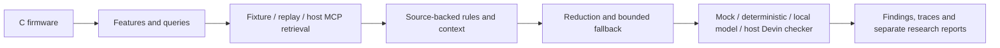

# Firmware-Aware Coding Guidelines Checker (FCGC)

FCGC finds guidelines relevant to C firmware, preserves their source context, and
passes a traceable evidence bundle to an interchangeable compliance checker.

Start with **[START_HERE.md](START_HERE.md)** for a five-minute tour.

## The problem

Firmware guidelines can be spread across documents, expressed in prose, and
qualified by exceptions elsewhere on a page. FCGC investigates whether code-aware
retrieval can find useful rules with less unnecessary context. It keeps original
wording, conditions and citations available for review.

This is a **local-first research prototype**, version 0.13.0. Bundled examples and
benchmark rules are synthetic, **not official WD requirements**.

## Main features

- Deterministic C feature extraction and configurable guideline query planning.
- Offline fixture and recorded-response retrieval; typed agent-mediated MCP handoff.
- Contextual rule extraction, conservative reduction and bounded retrieval fallback.
- Shared checking instructions, validated findings and explicit uncertainty.
- B0/P1/P2/P3 comparisons, replay and separate quality/cost reports.

## Quick start

Python 3.11+ is required. The tested local platform is macOS arm64 / Python 3.13;
other targets need compatible dependency wheels and validation.

```sh
python3 -m venv .venv
.venv/bin/python -m pip install -r requirements.lock
.venv/bin/python -m pip install --no-deps --no-build-isolation -e .
.venv/bin/fcgc agent invoke --command '/fcg-doctor' --output outputs/checks/doctor
.venv/bin/fcgc agent invoke --command '/fcg-check examples/firmware/sensor_start.c' --output outputs/checks/first-check
```

Open `outputs/checks/first-check/report.md`. Local defaults use synthetic retrieval
and an abstaining mock checker: **not_evaluated** is expected. A bounded genuine
deterministic checking example is in the [user guide](docs/USER_GUIDE.md).
Use fresh output directories. For installation without network access, see
[Local setup](docs/LOCAL_SETUP.md).

## Devin commands

In a supported Devin environment, use the commands directly; the agent performs
backend steps and presents the report.

| Command | Purpose | Example |
| --- | --- | --- |
| `/fcg-doctor` | Diagnose local setup and available host capabilities | `/fcg-doctor` |
| `/fcg-rules` | Inspect retrieved rules and their qualifications | `/fcg-rules examples/firmware/sensor_start.c` |
| `/fcg-check` | Check a file or named function with configured evidence/checker | `/fcg-check examples/firmware/sensor_start.c --function start_sensor` |
| `/fcg-compare` | Compare all four strategies on development cases | `/fcg-compare --case C001 --repeat 3` |
| `/fcg-report` | Report from saved experiments without new retrieval | `/fcg-report --experiment latest` |

All five backends work offline. Native recognition and live execution in WD's
Devin environment remain unverified. See [command options](docs/SLASH_COMMANDS.md).

## How it fits together



## Repository navigation

```text
START_HERE.md                First steps and an edit-safety map
config/                      Editable local and WD provider profiles
examples/                    Introductory synthetic C and guideline examples
src/fcgc/
  checking/                  Features, rules, evidence packing and checking workflow
  retrieval/                 Query planning, providers and retrieval strategies
  integrations/              Checker provider implementations
  agent/                     Devin command backend and typed handoff sessions
  experiments/               Experiment execution, metrics, statistics and replay
  schemas/                   Validated contracts; identifiers stay stable
  config/                    Internal defaults and versioned concept/template mappings
  fixtures/                  Packaged offline corpus and benchmark firmware
  core/, adapters/           Shared utilities and legacy import compatibility
research/experiments/        Editable research configuration files
benchmarks/v2/               Versioned dataset, separate labels and frozen references
skills/                      Canonical checking instructions and shared orchestration
.agents/skills/              Five discoverable Devin command definitions
tests/                       Unit, integration and end-to-end verification
docs/                        Focused user, developer, research and WD guides
outputs/                     New generated checks, experiments, reports and packages
```

Historic `runs/`, `release/` and benchmark reports keep their recorded paths.
`build/`, `dist/`, `.venv/` and `wheelhouse/` are generated/local support directories,
not application code. See the [directory guide](docs/DIRECTORY_GUIDE.md) for owners
and dependencies, and the [change map](docs/RESTRUCTURING_CHANGELOG.md) for old paths.

## Local and WD operation

`config/local.toml` selects the offline synthetic benchmark and mock.
`config/wd_agent.toml` selects the existing host's authorized Atlassian tools and
canonical checking handoff. Python does not assume direct access to Devin's MCP
session. `config/wd.example.toml` documents the unimplemented direct API contract;
it is not a runnable enterprise connection. No credentials are bundled.

Local mode needs no WD account, database, remote embeddings or paid model API.
WD mode requires actual authorized tools, scope and approved evidence storage.
It never silently substitutes synthetic sources. Firmware stays read-only.

## Research experiments

| Strategy | Change relative to generic retrieval |
| --- | --- |
| B0 | Generic fixed query; full fetched documents |
| P1 | Firmware-aware query planning |
| P2 | P1 plus source-backed rule context reduction |
| P3 | P2 plus sufficiency risk assessment and bounded fallback |

Optional R is a broad-reference retrieval configuration. All comparisons keep
providers, cases, corpus and checking instructions controlled; extra P3 costs are
recorded. Ground truth is separate from predictions, matched variants stay in the
same split, and held-out labels are never calibration inputs.

```sh
.venv/bin/fcgc experiment --config research/experiments/stage9_development.toml
.venv/bin/fcgc validate-local --dataset-root benchmarks/v2 --output outputs/validation/local
```

The second command runs all eight development cases, five strategies and three
repetitions, then produces reports, replays evidence and demonstrates bounded real
checking. Benchmark mocks do not establish AI compliance accuracy.
See the [research guide](docs/RESEARCH_GUIDE.md).

## Testing and development

```sh
.venv/bin/pytest -q
.venv/bin/ruff check .
.venv/bin/ruff format --check src tests scripts
.venv/bin/python -m pip check
.venv/bin/python scripts/build_release.py --output outputs/packages/local-release
```

The build output must be fresh. Old import paths remain forwarding aliases; use
`checking`, `retrieval` and `integrations` for new work. No core algorithms were
rewritten during the restructuring. See the [developer guide](docs/DEVELOPER_GUIDE.md).

## Documentation

- [User guide](docs/USER_GUIDE.md): checking, evidence inspection and supported results.
- [Directory guide](docs/DIRECTORY_GUIDE.md): what to edit and where features belong.
- [Developer guide](docs/DEVELOPER_GUIDE.md): imports, tests, configuration and extension.
- [Research guide](docs/RESEARCH_GUIDE.md): datasets, experiment execution and interpretation.
- [Architecture](docs/ARCHITECTURE.md) and [rule schema](docs/RULE_SCHEMA.md).
- [WD integration](docs/WD_INTEGRATION.md), [security](docs/SECURITY.md) and [limitations](docs/LIMITATIONS.md).
- [Restructuring change map and verification](docs/RESTRUCTURING_CHANGELOG.md).

## Current integration limitations

Native Devin slash invocation, authenticated WD MCP access and real Devin judgments
need target-environment verification. Pagination and arbitrary Confluence HTML/ADF
conversion are not implemented. Live enterprise experiment matrices require an
approved dataset/snapshot-storage adapter. Optional Ollama needs an explicitly
configured, available local model and network opt-in. The deterministic checker
supports only a narrow synthetic grammar. Dataset labels remain provisional.

Historical [transfer audit](docs/WD_TRANSFER_READINESS_REPORT.md) documents the
0.12.1 baseline; the change map records current refactoring validation. Neither
synthetic results nor this reorganization establish enterprise performance.
