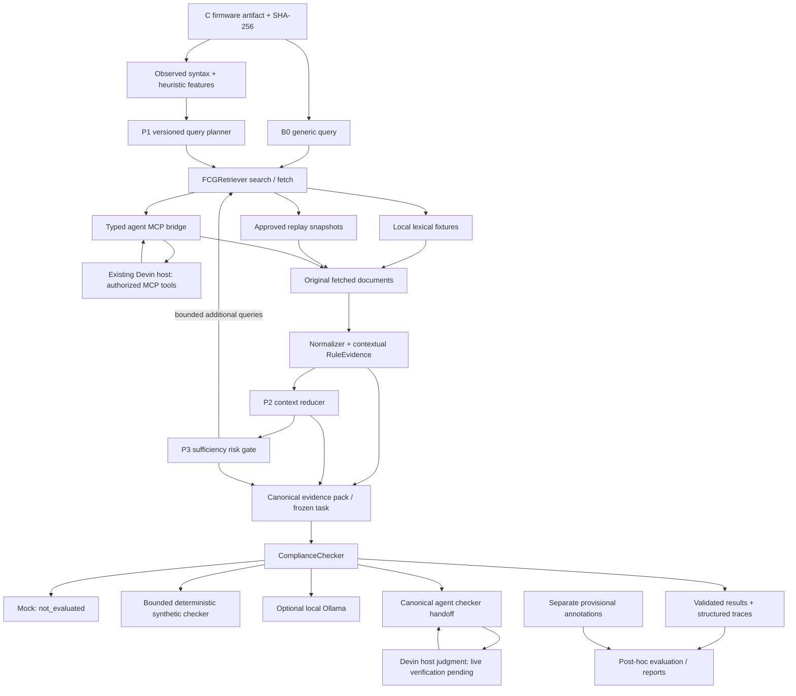

# Architecture

FCGC uses Pydantic v2 contracts around provider-independent processing. The CLI
and experiment runner call the same strategy executor, task freezer and checker
workflow. Firmware/rule processing lives in `src/fcgc/checking`, evidence discovery in
`src/fcgc/retrieval`, and checker implementations in `src/fcgc/integrations`.
`agent/` handles host orchestration; `experiments/` handles controlled runs and evaluation.
`core/` retains shared input safety/interfaces and compatibility imports; old
`adapters/` imports forward to the new implementations. Provider selection remains
in `fcgc.config`. See [the directory map](DIRECTORY_GUIDE.md) for file ownership. Ground truth is an evaluation-only input.

`FCGRetriever.search(query, top_k) -> SearchResults` returns ordered references;
`fetch(source_id) -> FetchedDocument` returns actual wording and identity/version.
Scope is selected in provider configuration and applied to search and fetch.
Provider responses are revalidated, including mutated typed instances. Fetch
identity must agree with the search hit. The recorder retains content-bearing
responses and errors; the ordered replay provider never constructs a live retriever.

`ComplianceChecker.check(request) -> CheckerResult` supports the original
`CheckerRequest` and canonical `FrozenCheckingTask`; canonical adapters return
`CheckingResult`. The host validates the evidence hash, source spans, finding IDs,
citations, code locations and provider counters. No checker influences retrieval.
Fresh provider/checker instances and task copies isolate experiment observations.

B0/P1/R preserve fetched documents in the canonical prompt. P2/P3 retain selected
rules with conditions, exceptions, definitions, dependencies and larger review
sections. The host keeps full originals for audit even in reduced mode. Context
budgets apply to both the Stage 6 pack and final skill/schema prompt. Failure to
fit is explicit and blocks substantive checker execution.

Planning uses runtime observations only. Rule catalogs and annotations support
validation and post-hoc metrics; no applicability labels enter queries or checking.
Experiment locks capture code/config, corpus, artifact and instruction fingerprints.
Evaluation records annotation hashes independently. Exact replay requires the
recorded content and compatible code/instructions; timing is measured anew.
