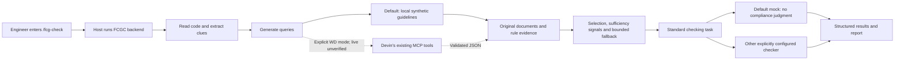

# How FCGC works

This guide explains the current **0.13.0 implementation**, rather than a future
proposal. All examples use synthetic code and guidelines, not official WD
requirements. Read this first, then consult the [file interaction map](FILE_INTERACTION_MAP.md),
[research workflow](RESEARCH_WORKFLOW.md), [editing and migration guide](WHERE_TO_EDIT.md)
and [workflow diagrams](WORKFLOW_DIAGRAMS.md) as needed.

## Understand it in one minute

Suppose a firmware engineer wants to check a C function and enters:

```text
/fcg-check src/flash_manager.c
```

The current system works as follows:

1. A Devin host that supports these skills reads the command instructions and runs the FCGC backend.
2. FCGC reads the C file and records its original text and SHA-256 fingerprint. It does not modify or execute firmware.
3. It observes clues such as calls, return-value assignments, conditions and pointer operations.
4. It turns those clues into guideline search queries.
5. **By default, it searches synthetic guidelines locally.** Explicit WD mode instead asks Devin to use its existing Atlassian MCP tools.
6. It fetches original documents and organizes their requirements, conditions, exceptions and references into traceable evidence.
7. The default P3 strategy selects evidence, assesses warning signals and performs additional retrieval within its budget.
8. It combines the original code, selected evidence and standard checking instructions into a task.
9. The checker returns supported findings or explicitly abstains. The default local mock only returns `not_evaluated`.
10. It saves structured records and `report.md`, which the host presents to the engineer.

`src/flash_manager.c` is an illustrative user-project path, not a bundled file.
Without `--function`, the scope is the whole file. Adding `--function NAME`
limits finding locations, while retaining the complete file as context.
The local backend has been executed; native Devin command recognition, real WD
MCP permissions and real Devin inference have not been verified here.



## What is the first entry point?

First comes the instruction file
[`.agents/skills/fcg-check/SKILL.md`](../.agents/skills/fcg-check/SKILL.md).
It directs the host to follow
[`skills/fcg_orchestration/WORKFLOW.md`](../skills/fcg_orchestration/WORKFLOW.md).
A skill is an instruction document for the host, not an automatically executed
Python plugin. The repository does not implement Devin or a slash-command listener.

The host then executes `fcgc agent invoke`. `pyproject.toml` defines the Python
entry point as `fcgc.cli:app`:

```text
src/fcgc/cli.py                         Registers commands
  → src/fcgc/agent/cli.py               invoke_command()
  → src/fcgc/agent/commands.py          invoke() / parse_command()
  → src/fcgc/agent/session.py           start_session() / advance()
  → src/fcgc/experiments/runner.py      perform_run() / execute_strategy()
```

Typer is the library that routes command-line arguments to Python functions.
Although the shared executor lives in `src/fcgc/experiments/runner.py`, single-file
checks also use it; that file is not exclusively for research experiments.

## Follow an example that was actually executed

The documentation verification ran this request, writing outputs to a temporary
directory without changing the application or dataset:

```text
/fcg-check src/fcgc/fixtures/benchmark_cases/C001.c --function boot_sensor --mode local
```

The input is
[`src/fcgc/fixtures/benchmark_cases/C001.c`](../src/fcgc/fixtures/benchmark_cases/C001.c):

```c
#include <stddef.h>
int sensor_open(void **handle);
int sensor_configure(void *handle);
int boot_sensor(void) {
    void *handle = NULL;
    int rc = sensor_open(&handle);
    if (rc != 0) return rc;
    return sensor_configure(handle);
}
```

The JSON examples below are projections of actual output fields, with unrelated
fields omitted. They do not present guesses as execution results. Shortened Python
module paths such as `checking/` and `retrieval/` are under `src/fcgc/`; the file
interaction map provides complete paths.

### A–B: From source code to features

`src/fcgc/retrieval/baseline.py::load_firmware()` creates `FirmwareInput`, containing
the original code, filename, case ID and hash.
`src/fcgc/checking/feature_extractor.py::extract_features()` uses a tree-sitter C
syntax tree and observed:

| Observation | Actual result |
| --- | --- |
| Analysis mode | `tree_sitter_ast` |
| Function scope | `boot_sensor`, original lines 4–9 |
| First call | `sensor_open` at line 6, assigned to `rc` |
| Subsequent observable check | Condition at line 7 contains `rc` |
| Subsequent return | `return rc;` at line 7 |
| Second call | `sensor_configure` at line 8, returned directly |
| Pointer expression | `&handle` at line 6 |
| Component hint | `sensor` |

The inferred categories were `api_return_handling`, `error_handling`,
`general_firmware`, `initialization`, `pointer_validation` and `resource_lifetime`.
These are marked `heuristic`: inferences from names and syntax, not compliance
judgments. A later condition mentioning `rc` does not prove that every execution
path checks the same return value. Macro expansion, indirect calls and analysis
across functions remain limited.

### C: From features to a query

`src/fcgc/retrieval/query_planner.py::FCGQueryPlanner.plan()` reads versioned concept
mappings and a template. The actual initial query was:

```text
synthetic C firmware coding guidelines resource lock handle cleanup release pointer null output validation dereference general firmware coding requirements sensor_configure sensor_open sensor
```

It used `feature-concepts-v2` and `p1-template-v2`. The template selects at most two
specific concepts, then adds general guideline concepts, API names and component
hints. Here it selected resource lifetime and pointer validation; it did not issue
one query for each of the six inferred categories. The planner does not read
applicability labels or use expected SFCG rule IDs as query answers.

### D: From search references to original documents

The local `LocalFixtureRetriever` ranks documents by the number of distinct tokens
shared between the query and the title/body. The first search returned:

| Rank | source_id | Local token-overlap score |
| --- | --- | ---: |
| 1 | `api_returns` | 8 |
| 2 | `decoy_host_tools` | 8 |
| 3 | `pointers` | 8 |

Ties are ordered by source ID. These scores are not semantic confidence or a
promise to reproduce Atlassian ranking. Search returns references;
`fetch(source_id)` returns original document content.
For example, `fcgc://synthetic-benchmark/api_returns.md` is a local source reference,
not a Confluence address. Its actual `document_version` was null; the dataset
version must not be substituted for it.

The document contains:

```text
1. [SFCG-001] After `sensor_open` succeeds, the returned handle may be used; a failed
   open must be handled before any handle access.
```

A decoy document appearing in retrieval results is something to record and study.
It does not mean the algorithm already knows whether that document applies.

### E: How documents become rule evidence

`src/fcgc/checking/document_normalizer.py` identifies headings, paragraphs, lists
and tables while preserving source positions.
`src/fcgc/checking/rule_extractor.py::extract_rule_evidence()` then distinguishes
requirements, explanations, examples, conditions, exceptions, definitions and
references. Actual extracted fields for the rule above include:

```json
{
  "evidence_id": "ev-84aee31b3b3ae48c",
  "source_id": "api_returns",
  "explicit_rule_id": "SFCG-001",
  "normative_statement": "After `sensor_open` succeeds, the returned handle may be used; a failed\n   open must be handled before any handle access.",
  "normative_span": {"start": 333, "end": 454, "start_line": 7, "end_line": 8},
  "ambiguity_status": "clear"
}
```

The full record also contains the original excerpt, source reference, heading
lineage, extraction method and condition ``After `sensor_open` succeeds,``.
Character offsets start at zero and exclude the end position; line numbers start
at one. `normative` means operative guidance, not that every sentence containing
must/should automatically becomes an independent mandatory rule.

A separate extraction command processed
[`examples/guidelines/transfer.md`](../examples/guidelines/transfer.md).
**This teaching example is not in the default retrieval corpus**, so it must not
be presented as a result of the preceding search. Its content includes:

```text
When an asynchronous transfer is pending, its caller must retain the submitted
buffer until completion. The caller must preserve its transaction identifier.

Exception: A confirmed cancellation may release the buffer early.
```

It produced two candidates. Both preserved the preceding condition and later
exception, were marked `review_required`, and retained larger paragraph context.
Proximity suggests shared scope but cannot establish the interpretation with
certainty. The explanatory Note did not automatically become a third requirement.
When no explicit rule number exists, the system generates an `ev-…` evidence ID;
that is not an official rule identifier.

### F–G: Selecting evidence and assessing sufficiency are different

The reducer asks, “Which evidence should be retained?” It checks source positions,
considers API/category/component/scope signals, preserves uncertainty and restores
recognized rule dependencies. Missing token overlap alone does not establish
inapplicability. Clear bindings to a different API, explicit scope conflicts and
matching-scope duplicates can justify exclusions.

The sufficiency gate asks, “What warning signals remain?” The actual rounds were:

| Round | Query intent | Newly fetched sources | Reason to continue or stop |
| --- | --- | --- | --- |
| 1 | Initial resource/pointer query | `api_returns`, `decoy_host_tools`, `pointers` | Missing initialization signal and uncertain applicability |
| 2 | `C firmware coding requirements initializ configur enable reset sensor` | `initialization` | Applicability remained uncertain |
| 3 | `C firmware coding requirements applicability conditions exceptions shared definitions sensor` | `decoy_bootloader` | Three-round limit reached |

Repeated source references were not fetched again. The final five documents yielded
**19 candidates: 17 retained and two excluded**. SFCG-002's `flash_write` and
SFCG-003's `adc_read` were not observed in the code; their exclusion reason was
`specific_api_binding_unobserved`. Some uncertain decoy-context evidence remained;
the system did not claim to understand every applicability condition.

The initialization signal recovered, but final sufficiency remained
`insufficient_evidence`, with reason `ambiguous_applicability` and stop reason
`retrieval_round_limit`. The current gate also treats the presence of conditions
or exceptions as warning signals, so even a rule extracted as `clear` may trigger
it. **Recovering a category signal does not prove that all applicable rules were found.**

### H: How evidence reaches the checker

`pack_checker_input()` preserved complete required spans. This intermediate pack
was estimated at **997 tokens**. `freeze_packed_audit()` converted it into a
standard `FrozenCheckingTask`; `render_checking_prompt()` then added the shared
checking skill, task JSON and output schema. The final input, including function
focus, was estimated at **6,590 tokens**. These measurements count different text
and must not be treated as the same token metric.

The task contains the original firmware, 17 selected rules with their conditions,
exceptions/dependencies, warnings and original function coordinates. Its status is
`incomplete_context`. The host retains full originals for audit; P2/P3 model input
omits document bodies while retaining document identity and selected rule context.
Insufficient budget produces an explicit failure or incomplete status, not silent
truncation of requirements.

### I–J: Actual results and the user-facing report

Because context was incomplete, the standard checking workflow returned unresolved
findings without substantive judgment:

```json
{
  "status": "complete",
  "checker_status": "not_evaluated",
  "rules_evaluated": 0,
  "violations_found": 0,
  "unresolved_checks": 17,
  "evidence_status": "incomplete_context",
  "counts": {"search_calls": 3, "fetch_calls": 5, "transport_retries": 0}
}
```

Zero violations does not mean “passed”: no rule was substantively evaluated.
The following is an actual report excerpt, with the developer's absolute file path
shortened to a repository-relative path for display:

```text
# FCG Compliance Report
File: src/fcgc/fixtures/benchmark_cases/C001.c. Function: boot_sensor.
Mode/strategy: local/p3.
Retrieval: benchmark. Workflow: complete.
Checker: not_evaluated. Evidence: incomplete_context.
Checker: mock/mock-contract-v1.
- SFCG-001: unresolved/unresolved; No evidence or incomplete evidence context.
  Source: fcgc://synthetic-benchmark/api_returns.md; original lines 7-8.
  Condition: After `sensor_open` succeeds,
```

`src/fcgc/agent/session.py::render_report()` builds the report from validated data;
it does not ask another model to invent an overall verdict. “Workflow complete,”
“context complete” and “a rule is compliant” are separate concepts.

A separate demonstration froze `src/fcgc/fixtures/checking/pointer_bad.c` with its
explicitly supplied `src/fcgc/fixtures/checking/pointer.md` and sent it to the
bounded deterministic checker. It produced:

```json
{
  "provider": "synthetic_demo",
  "model": "single-pointer-store-v1",
  "status": "evaluated",
  "applicability": "applies",
  "decision": "violating",
  "code_line": 3,
  "code_excerpt": "    *out = 7;",
  "source_quote": "A required output pointer must be checked for null before its first write."
}
```

This is a projection of the actual structured result. The checker supports only
the specified single-pointer-store grammar and SFCG-981; it is not general C
analysis or validated AI accuracy. The same task sent to the mock remained
`not_evaluated`. Reproduction commands are in the existing [user guide](USER_GUIDE.md).

## What Devin, MCP and Python each do

Think of Python as an analyst preparing a library request, and Devin as someone
who can use an already authorized library desk. Devin's access does not give
Python that login session. Devin must retrieve the requested original pages and
their references.

| Name | Meaning here |
| --- | --- |
| Devin | External coding-agent host, not a service implemented by this Python package |
| Slash command | The engineer's `/fcg-check …` request |
| Skill | Instructions telling the host how to execute the request |
| Confluence | The document system intended to hold future real guidelines |
| Atlassian MCP | The host's existing authorized search/fetch tool interface |
| Python engine | The application analyzing code, planning queries, organizing evidence and validating results |
| Agent-mediated bridge | The typed request/receipt mechanism between host and engine |

In WD mode, `AgentMCPRetriever` first consumes accepted receipts. When an operation
has no receipt yet, it raises `AgentRetrievalRequired`. The session saves
`action.json` and returns `retrieval_required`. Devin reads the requested query or
source, invokes the actual visible existing tool, writes its response as JSON and runs:

```text
fcgc agent submit --session <session-directory> --response <reply.json>
```

Python validates it and continues. The transport is **JSON files plus CLI
arguments/stdout**, not a hidden Python MCP connection, stdin streaming service
or Devin API. Each continuation repeats deterministic Python processing and reuses
old receipts in order until the next physical-call boundary. Completed tool calls
are not reissued. P3 fallback queries use the same loop.

A complete Devin checking task yields `checking_required`. The host follows the
exact canonical prompt and returns an `AgentJudgment`; incomplete context blocks
substantive judgments. Source IDs, references, order, scope and timestamps are
checked at the boundary; available versions are preserved. Receipts must not carry
credentials. Authentication or permission errors stop WD execution, and unavailable
tools never trigger synthetic substitution. See the [interaction map](FILE_INTERACTION_MAP.md)
for precise fields and failure branches.

## Local versus WD operation

| Concern | Locally verified path | WD path and remaining verification |
| --- | --- | --- |
| Firmware | Local synthetic C, read-only | Code inside the approved host workspace; shared validation |
| Guidelines | Bundled synthetic Markdown | Authorized Confluence content; no live access verified |
| Search/fetch | Lexical fixtures or recorded replay | Existing Devin MCP tools; fake-transport contract tests only |
| Rule processing | Normalization, extraction, selection, gate and packing | Shared Python core; actual content mapping needs verification |
| Checker | Mock, bounded deterministic demonstration, optional local-model adapter | Host judgment ingestion implemented; real Devin inference unverified |
| Command host | Backend and skill metadata verified | Native Devin recognition/invocation needs target verification |
| Authentication | No account needed locally | Existing host authorization; no independent Python OAuth |
| Logging | Source-bearing local records | WD-approved storage, access and retention required |
| Experiments | Synthetic evaluation works | Enterprise dataset, snapshot governance and live matrix adapter not implemented |

`--mode wd --config config/wd_agent.toml` selects a route; it does not guarantee
successful integration. Actual tool names, schemas, permissions, page versions and
model behavior require verification. Direct Atlassian/Devin APIs remain
unimplemented contracts. Arbitrary HTML/ADF conversion and automatic MCP pagination
are not implemented; the default query template retains synthetic-corpus vocabulary
and does not automatically switch to enterprise concepts.

## What to do after migration

**After directory restructuring:** update old configuration and test-script paths;
use `checking/`, `retrieval/` and `integrations/` for new code, and `outputs/` for
new results. Keep historical snapshots with their original release. Do not replace
old code hashes with new ones to bypass replay validation.

**After transfer into WD:** verify the target offline installation, then all five
native commands, existing MCP tools/permissions and one approved document's exact
text/version mapping. Review `/fcg-rules` evidence before a genuine `/fcg-check`
judgment and citation review, then perform independent annotation review and
controlled experiments. Approve log storage and model-use boundaries as well.
See the [migration follow-up checklist](WHERE_TO_EDIT.md#migration-follow-up-tasks).

## Recommended reading order

1. This guide: understand how the data changes.
2. [FILE_INTERACTION_MAP](FILE_INTERACTION_MAP.md): follow functions, models and configuration.
3. [WORKFLOW_DIAGRAMS](WORKFLOW_DIAGRAMS.md): see branches and host suspension/resumption.
4. [RESEARCH_WORKFLOW](RESEARCH_WORKFLOW.md): understand experiments, evaluation and replay.
5. [WHERE_TO_EDIT](WHERE_TO_EDIT.md): find modification points and outstanding migration work.

For installation, directory ownership and deployment constraints, continue with
[LOCAL_SETUP](LOCAL_SETUP.md), [DIRECTORY_GUIDE](DIRECTORY_GUIDE.md) and
[WD_INTEGRATION](WD_INTEGRATION.md), rather than duplicating those full manuals here.
