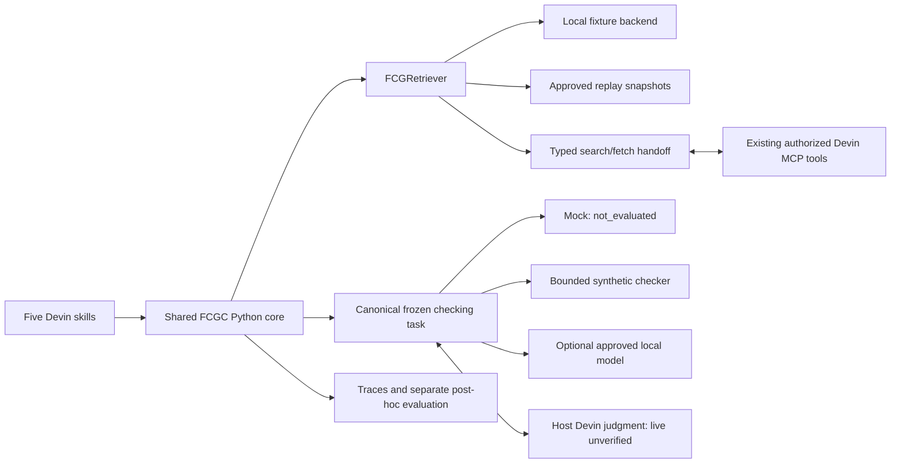

# FCGC pre-deployment transfer readiness audit

Audit date: 2026-11-12. Release: **0.12.1**. Scope: transfer into the authorized WD environment for integration testing. This is a local synthetic research prototype; live WD operation and general firmware compliance accuracy have not been established.

## A. Executive summary

**READY WITH CONDITIONS**

The locally testable pipeline works, including structured source-backed evidence, bounded fallback, checking contracts, experimental comparisons, evaluation and content replay. The final repository suite passes **208 tests**. A separate environment installed the wheel without an index and passed the same **208 tests** from an extracted source archive, plus the full 120-run acceptance workflow. All five engineer-facing command backends executed successfully. Actual Devin slash-command discovery and invocation remain unverified because neither a Devin executable nor authorized Atlassian tools are exposed here.

Safe, scoped fixes addressed credential-bearing transport metadata, private-config packaging, conditional-context loss, definition-sensitive deduplication, function-focus validation, checker metadata and evaluation controls. No firmware fixtures or ground-truth labels were edited. No WD service, commercial model, package index or external advisory service was contacted during this audit. There is no second MCP server or independent enterprise authentication implementation.

Conditions before live use: validate the target Python/platform dependency set; establish approved storage/retention boundaries; verify native Devin skill recognition and the existing authorized MCP tools; validate the actual content format, scope, source identity and version mapping; then perform a small authorized live check with genuine host judgments. Enterprise experiment matrices and production snapshot governance still need an approved implementation. Transfer readiness does not authorize production checking or publication of proprietary evidence.

Evidence root, relative to the checkout: `runs/predeploy-audit-20261112/`. Final code fingerprint: `b4c7279077b1a0aabf5dae87ca1cd5bc5c9925a88d3c593ab1d0da27b9bffcc7`. Dataset version `2.0.0`; annotations `1.0.0-provisional`; checking skill `1.1.0`; prompt `FCGC-PROMPT-V1`; checker output schema `model-findings-v1`. Earlier audit outputs remain for comparison; use `*-final` outputs for the accepted code.

Initial-state caveat: the directory has no Git metadata. Uncommitted user changes cannot be distinguished from committed files. Before editing, the audit saved hashes of 222 existing project files in `before-files.json`, diagnostics and environment facts in `initial-state.json`. Existing content was preserved except the scoped files recorded below; no reset or broad cleanup was performed. All 28 pre-existing C fixtures retain their original hashes.

## B. Component readiness matrix

Paths below are relative to the project root. Test filenames identify executable verification, not merely the existence of implementation files.

| Component | Implementation | Functional verification | Remaining issues |
| --- | --- | --- | --- |
| Contracts and interfaces | `schemas/` under `src/fcgc/`; `core/interfaces.py` | Pydantic extra-field rejection, instance revalidation, contract and citation tests; 62 modules import | No static type checker configured; runtime validation is not a type proof |
| C feature extraction | `core/features.py`, `core/artifact_target.py` | `test_stage3.py`, `test_agent.py`; real C001 AST output and function coordinates | Syntax observations plus heuristic categories; lexical fallback; macros/indirect calls remain uncertain, no complete data flow |
| Query planner | `core/query_planner.py`, `config/feature_concepts_v2.json`, `config/p1_templates_v2.toml` | Versioned runtime-only queries in 120 final traces; `test_stage3.py`, `test_stage4.py` | Synthetic vocabulary; mapping quality needs independent enterprise evaluation |
| B0 baseline | `core/baseline.py`, `core/retrieval.py` | 24 final B0 runs; constant query; provider errors revalidated | Diagnostic feature logging does not affect B0 retrieval |
| Local fixture retrieval | `adapters/retrieval/local.py`, `benchmark.py` | Stable lexical ranking, search/fetch scope, deep-copy isolation; `test_stage4.py`, `test_release.py` | Test backend, not an emulation of managed Atlassian semantic ranking |
| Replay retrieval | `adapters/retrieval/replay.py`, `experiments/snapshots.py` | Final P3 replay consistent; absent snapshot rejected; `test_stage9.py` | Requires content snapshots and compatible code/instructions; hashes alone cannot replay |
| Direct MCP adapter | `adapters/retrieval/atlassian.py` | Explicit `NotImplementedError`, enterprise-contract tests | Deliberate direct-Python stub; native route uses host bridge instead |
| Agent-mediated MCP bridge | `adapters/retrieval/agent.py`, `agent/session.py`, `schemas/agent.py` | Fake search/fetch/check handoff; source IDs, scope, errors, budgets, tampering and partial responses tested in `test_agent.py` | Live host identity/tool/schema/scope mapping and actual authentication pending WD verification |
| Document normalization | `core/document_normalizer.py` | Markdown/list/table/prose normalization with exact offsets; `test_stage5.py` | Plain text/Markdown only at bridge ingress; no arbitrary Confluence HTML/ADF converter |
| Rule segmentation | `core/rule_segmentation.py`, `schemas/rules.py` | Conditions, later exceptions, definitions, tables, references and informative text; `test_stage5.py`, `test_predeployment.py` | Heuristic English segmentation; explicit-ID recognition currently targets synthetic `SFCG-NNN`; other ID formats require a verified mapping |
| Context reduction | `core/context_reducer.py` | Low-overlap evidence, dependency closure, different scopes/definitions and audit decisions; `test_stage6.py`, `test_predeployment.py` | Conservatism retains uncertainty; no semantic completeness guarantee |
| Sufficiency gate/fallback | `core/p3.py`, `schemas/stage7.py` | Complete/empty/missing-category/dependency/duplicate/error/limit scenarios; `test_stage7.py`; final P3 bounded traces | Risk detector only; ambiguity can remain after every round; soft elapsed limit does not cancel an in-flight host call |
| Context packing | `core/context_packer.py`, `core/checking.py` | Verbatim clauses, qualifiers and full review sections; explicit budget failures | Local tokenizer approximation; whole context can exceed budget, never silently truncated |
| Checker workflow | `core/checking.py`, `schemas/checking.py`, `core/interfaces.py` | Frozen tasks, prompt hashes, rule/source/code citation validation, malformed JSON and uncertainty tests | Evidence cannot prove that every applicable rule was found |
| Mock/legacy placeholder | `adapters/checker/mock.py`, `placeholder.py` | Deterministic `not_evaluated`, no annotation reads, requested settings retained | No compliance accuracy or successful-compliance claim |
| Deterministic checker | `adapters/checker/demo.py` | Pointer good/bad fixtures evaluated with valid citations and locations | Only explicitly supported synthetic pointer-store grammar/SFCG-981; unsupported constructs abstain |
| Optional local LLM | `adapters/checker/local_llm.py` | Transport/metadata/timeout/malformed response contract tests | Ollama/model unavailable here; no real inference tested; explicit network opt-in required even on loopback |
| Devin checker | `adapters/checker/devin.py`, `devin_agent.py` | Direct API stub returns not_evaluated; host findings ingestion validated using simulation | Real host judgment, model metadata and native skill execution unverified; no automated Devin API invented |
| Native command orchestration | `.agents/skills/fcg-*/SKILL.md`, `agent/commands.py`, `agent/cli.py` | Five valid frontmatters, actual backend execution, argument/function/error tests | Files and backend success do not prove native recognition on the target Devin version |
| Canonical checking instructions | `skills/fcg_checking/SKILL.md`, `prompt.txt` | Same instruction assets across adapters; version/hash recorded; `test_stage8.py` | Shared prompts do not make model behavior equivalent |
| Experiment orchestration | `experiments/runner.py`, `schemas/stage9.py` | B0/P1/P2/P3/R, fresh instances, repeated runs, locks, failed-run traces; `test_stage9.py` | Live WD matrices intentionally blocked pending approved enterprise dataset/storage adapter |
| Evaluation/statistics | `experiments/evaluation.py`, `metrics.py`, `statistics.py`, `calibration*.py` | Known arithmetic fixtures, paired grouping, missing data, frozen held-out margins; `test_stage10.py`, `test_release.py`, `test_predeployment.py` | Provisional annotations and four development groups limit inference; no held-out tuning performed |
| Logging/snapshots | `experiments/runner.py`, `run_log.py`, `snapshots.py`; `agent/session.py` | JSON traces contain actual queries, ranked responses/content, evidence, decisions, checker metadata and timing; exact replay verified | Full artifacts contain source/prompt content; approval, access and retention controls belong to WD |
| Config/package/docs | `config/`, `examples/`, `experiments/`, `pyproject.toml`, lock files, `docs/` | Config syntax scan, provider selection, fresh source/wheel builds and isolated installation | Other target OS/Python versions and advisory/license review pending |

No conflicting abandoned architecture was found. The Stage 1 three-document `LocalLexicalRetriever` remains a compatibility path; `LocalFixtureRetriever`/`BenchmarkLexicalRetriever` select the Stage 2 corpus. Older RQ1 helpers and Stage 6 requests remain supported alongside the canonical runner/tasks. `CheckingResult` extends the original `CheckerResult` contract. Core code has no WD URLs, guessed tool names or independent OAuth implementation.



## C. Slash-command readiness

All five files have matching directory/name, nonempty workflow, JSON-compatible YAML frontmatter (`name`, `description`, `argument-hint`, `triggers`), and no tool auto-approval or permission overrides. Backend parsing uses shlex/argparse, not shell evaluation. The shared workflow is `skills/fcg_orchestration/WORKFLOW.md`. The canonical checking skill is separate from orchestration.

| Intended engineer command | Actual local backend outcome | Final evidence | Native WD status |
| --- | --- | --- | --- |
| `/fcg-doctor` | Complete; local provider/dataset/skills ready | `native-doctor-final/doctor.json` | Discovery/invocation unverified |
| `/fcg-check … --function boot_sensor --mode local` | Complete workflow; mock not_evaluated; P3 incomplete context reported | `native-check-final/{report.md,result.json,trace.json}` | WD orchestration implemented; live invocation unverified |
| `/fcg-rules … --mode local` | Complete evidence/selection report; no checker invoked | `native-rules-final/` | Live invocation unverified |
| `/fcg-compare --case C001 --repeat 3` | 24/24 runs finished, 0 failed; matched C001/C002 kept together, 12 incomplete | `native-compare-final/{experiment,evaluation}/` | Local comparison supported; enterprise matrix explicitly unimplemented |
| `/fcg-report --experiment …/native-compare-final` | Saved-trace reports generated; retrieval_rerun=false | `native-report-final/` | Native invocation unverified; no live retrieval needed |

The active Codex skill catalog exposes these project skills, but that is not a native Devin test. No Devin executable exists here. On WD the engineer invokes the slash command; its agent runs the backend and handles pending typed actions. The engineer should not have to manually run each Python step. An invalid `--function main` on C001 was rejected because C001 defines `boot_sensor`; the valid selection preserved original lines 4–9 and the full artifact. No source modification occurred.

## D. Local end-to-end results and exact commands

Run these from the project root. Output directories must be fresh. The commands below were executed successfully; detailed arguments/exits are in `final-command-receipts.json`, with stdout/stderr beside it.

```sh
.venv/bin/fcgc validate-local --dataset-root benchmarks/v2 --output runs/predeploy-audit-20261112/acceptance-final
.venv/bin/fcgc agent invoke --command '/fcg-doctor' --output runs/predeploy-audit-20261112/native-doctor-final
.venv/bin/fcgc agent invoke --command '/fcg-check src/fcgc/fixtures/benchmark_cases/C001.c --function boot_sensor --mode local' --output runs/predeploy-audit-20261112/native-check-final
.venv/bin/fcgc agent invoke --command '/fcg-rules src/fcgc/fixtures/benchmark_cases/C001.c --mode local' --output runs/predeploy-audit-20261112/native-rules-final
.venv/bin/fcgc agent invoke --command '/fcg-compare --case C001 --repeat 3' --output runs/predeploy-audit-20261112/native-compare-final
.venv/bin/fcgc agent invoke --command '/fcg-report --experiment runs/predeploy-audit-20261112/native-compare-final' --output runs/predeploy-audit-20261112/native-report-final
```

The one-command `validate-local` path performs firmware load → features → queries → local search/fetch → normalization/segmentation → reduction → sufficiency/fallback for P3 → canonical packing → checker/validation → traces → post-hoc reports. It also checks dataset quality, replays P3 evidence and runs genuine bounded deterministic checks. Final saved summary:

```json
{
  "accepted": true,
  "runs": 120,
  "finished": 120,
  "failed": 0,
  "incomplete_context_runs": 54,
  "exact_evidence_replay": true,
  "checker_status_counts": {"not_evaluated": 120},
  "deterministic_demonstration": {
    "good": {"status": "evaluated", "decisions": ["compliant"]},
    "bad": {"status": "evaluated", "decisions": ["violating"]}
  },
  "enterprise_verified": false
}
```

“Finished” means the workflow finished recording its outcome, not that context or compliance was proven complete. Incompleteness was explicit: B0 0/24, P1 3/24, P2 3/24, P3 24/24, R 24/24. Broad-reference R exceeded the final prompt budget; P3 remained insufficient due to conservative ambiguity/dependency signals. The mock abstained throughout, including otherwise complete tasks. The standalone deterministic `pointer_bad.c` demonstration cites the supplied synthetic source and the unguarded store on line 3; this is not a model-generated result.

Evidence files:

```text
runs/predeploy-audit-20261112/
  before-files.json, initial-state.json, pre-fix-*.json
  final-command-receipts.json, final-trace-assurance.json
  pytest-final.txt, ruff-check.txt, ruff-format.txt
  security-config-scan.json, import-dependency-checks.json
  known-metric-verification.json, firmware-unchanged.json
  acceptance-final/
    acceptance.json, dataset-quality.json, experiment.toml, evaluation.toml
    experiment/lock.json, summary.json, runs/<id>/trace.json
    experiment/runs/<id>/task.json, checker_prompt.txt
    experiment/snapshots/<id>.json
    deterministic/{good,bad}-{task,result}.json
    replay/trace.json
    evaluation/{metrics.json,summary.csv,runs.csv,paired.csv,report.md,report.html}
  native-{doctor,check,rules,compare,report}-final/
  simulated-handoff-final/session/     # synthetic transport contract exercise only
  missing-snapshot-final.json         # expected fail-closed result
  cleanroom-final.json, cleanroom-final-*.txt
  cleanroom-acceptance-final/
  artifacts-final/                    # fresh source archive, wheel, SHA256SUMS
```

Other exercised commands: `fcgc info`, `fcgc features --source src/fcgc/fixtures/benchmark_cases/C001.c --output runs/predeploy-audit-20261112/features.json`, and `fcgc extract-rules --document src/fcgc/fixtures/segmentation/contextual_rules.md --output runs/predeploy-audit-20261112/rules.json`. See `command-receipts.json` for these earlier smoke invocations. To replay the final accepted code explicitly into a new directory:

```sh
.venv/bin/fcgc replay --run runs/predeploy-audit-20261112/acceptance-final/experiment/runs/C001-p3-r01/trace.json --output runs/final-replay-example
.venv/bin/fcgc report --config runs/predeploy-audit-20261112/acceptance-final/evaluation.toml
```

The acceptance command already executed an exact P3 replay. A copied experiment with its content store deliberately absent returned `Exact replay impossible: snapshot unavailable: …/snapshots/C001-p3-r01.json`. No live retriever was substituted. Replaying older traces after a source change correctly requires their matching code/instructions.

Context-preservation regression example, entirely synthetic:

```text
When a transfer is pending, the caller must retain its buffer until completion.
The caller must preserve its identifier.

Exception: A confirmed cancellation may release the buffer early.
```

Segmentation creates two verbatim normative candidates. The follow-up candidate retains the preceding condition, full paragraph/relevant later exception and a review-required note because the inherited scope is uncertain. Even packing that follow-up by itself preserves “When a transfer is pending” and the exception. Distinct definitions such as “small frame means at most 16 bytes” versus “at most 32 bytes” remain separate evidence; distinct canonical rule IDs are also retained. Tests verify exact source slices, version and provenance, not rewritten summaries. Informative notes/examples are separate from requirements. This is conservative contextual preservation, not complete natural-language interpretation.

Representative failure coverage includes missing/empty/NUL/oversized sources, CRLF offsets, parse errors, unsupported checker syntax, absent/ambiguous evidence, missing dependencies, empty and duplicate-only retrieval, mutated provider objects, unknown/fabricated citations, malformed model/transport JSON, unavailable models, authentication/permission errors, timeouts, resource exhaustion, partial replies, stale/tampered receipts and output symlinks. These are locally exercised error/contract paths; model timeouts and enterprise failures are simulated.

## E. Research configurations and measured results

The full corpus loads offline: **36 synthetic rules in eight documents**, six categories, **24 cases** split eight development / 16 held-out. All 24 annotations validate structurally and remain provisional pending independent firmware review. Cases and matched variants remain grouped by split. The runtime uses public cases/features/corpus only; label access is in quality checking and post-hoc evaluation, with guard tests against runtime label reads. No held-out calibration/effectiveness experiment was run.

| Configuration | Actual behavior | Final run budget |
| --- | --- | --- |
| B0 | Constant `firmware coding guidelines C source`; normal backend search/fetch; full documents | 1 search, document Top-K=3, up to 3 fetches; no fallback/reduction |
| P1 | Runtime features → concepts/templates → one combined targeted query; full documents | Same search/fetch budget as B0; no fallback/reduction |
| P2 | P1 retrieval plus source-backed rule reduction/packing | Same retrieval budget; no fallback |
| P3 | P1 + reduction + observable gate + bounded additional retrieval/repacking | At most 3 total rounds/searches, 8 fetches, 8 unique candidate sources; Top-K=3 per search; local soft 5 s deadline |
| R | Optional broad-reference generic search; full documents | 1 search, Top-K=8, up to 8 fetches; no fallback/reduction |

All used the same lexical benchmark backend, full source scope, corpus, firmware hashes, checker settings, canonical skill/prompt and dataset version. Three repetitions per development case, shuffled with seed 2026, yielded 120 observations. Fresh providers/checkers were constructed per run. P3 has a deliberately larger retrieval budget; it is not a matched-cost improvement claim. The reduction pack has its own default 3,000-token estimated budget; the final canonical task/prompt cap is 12,000. These are distinct measurements and failures are explicit.

**Rule K=18** means unique canonical rule IDs after document arrival order, source line and ID, not 18 documents and not a fabricated semantic rule score. Precision divides by actual unique returned rules up to K. Candidate/fetched, retained and adapter-received coverage are reported separately; ID-less rules remain auditable but cannot be scored against canonical-ID ground truth. The checker receiving a task is not evidence that a model evaluated it.

Final macro averages, repetitions averaged within each of eight cases:

| Strategy | Fetched Recall@18 | Precision@18 | Retained / adapter-received Recall@18 | Retrieved-context tokens | Final input tokens | Search / fetch calls | End-to-end ms |
| --- | ---: | ---: | ---: | ---: | ---: | ---: | ---: |
| B0 | 0.4375 | 0.0833 | 0.4375 / 0.4375 | 614.00 | 5717.88 | 1 / 3 | 7.77 |
| P1 | 0.9167 | 0.1632 | 0.9167 / 0.9167 | 684.38 | 6707.38 | 1 / 3 | 8.77 |
| P2 | 0.9167 | 0.1632 | 0.9167 / 0.9167 | 684.38 | 5598.38 | 1 / 3 | 10.83 |
| P3 | 0.9167 | 0.1389 | 0.9167 / 0.9167 | 1025.25 | 7576.75 | 3 / 5.375 | 20.63 |
| R | 0.4375 | 0.0556 | 0.4375 / 0.4375 | 1609.00 | 14387.88 | 1 / 8 | 17.61 |

These are local regex token estimates (`regex-word-punctuation-v1`) and measured local wall-clock times. Prepared over-budget prompts are counted as prepared tokens; they were not submitted to a model. Output/provider-total/billed tokens, ACU, Rovo credits and real MCP calls are unavailable, not zero. There are **zero compliance-eligible observations**; every benchmark checker returned not_evaluated. No compliance F1 or validated AI accuracy follows from this table.

O1: P1 increased average fetched recall on these provisional development labels, with C001 still missing two of three applicable rules at K. The group-bootstrap 95% interval for B0→P1 recall delta is [0.125, 0.8333], Holm-adjusted sign-flip p=0.75. Only four matched groups exist, so this does not establish a general or enterprise gain.

O2: P2 reduced mean prepared final input by 1,109 estimated tokens (about 16.5% relative to P1) with no measured canonical recall loss here. It added about 2.06 ms of local processing. Whether checking effectiveness is preserved is **unverified** because the benchmark used a mock and provisional labels.

O3: P3 recovered observable warning categories in some traces but did **not** increase Recall@18 over P2. It reduced mean precision, added two searches and 2.375 fetches per case, added 1,978.375 estimated final-input tokens and about 9.80 ms, and remained insufficient in all 24 P3 observations. Warning recovery is not independently established rule-recall recovery.

Repetition source/rule set Jaccard was 1.0 for this deterministic backend. Statistical inference averages repetitions within case, then uses matched-group means (four groups); 24 repeated strategy observations are not 24 independent cases. Reports include means/medians/SD/IQR, paired effects, bootstrap intervals, adjusted tests, per-case misses, uncertainty, lost evidence and incomplete observations. Known arithmetic fixture validation gave P=R=F2=0.5 at K=2; TP=1, FP=2, FN=1, precision=1/3, recall=0.5, F1=0.4, attribution=0.5. Zero denominators/missing billing are null; mock confusion counts are excluded. Checker results are now checked against locked provider/model/settings/instruction identities before evaluation; simulated agent traffic cannot be counted as real-model accuracy.

## F. MCP bridge and Devin checker readiness

**Implemented and tested locally:** versioned query handoff, ordered search-result ingestion, source-fetch ingestion, scope/identity/version/hash preservation, bounded receipt/session storage, canonical schema validation, source-backed normalization and reduction, fallback handoffs, tool-error propagation, incomplete-evidence marking and canonical judgment validation. A final fake-host exercise completed one search, one fetch and a supported synthetic judgment using the same core. It is labeled `synthetic_contract_test` / `simulated_devin_agent`; it generated no actual MCP traffic or Devin inference.

**Implemented, not live-verified:** suspending the Python workflow for the host to invoke an already authorized tool, then resuming from validated responses; checking handoff uses the same frozen task/instructions and accepts actual host findings. The backend cannot independently authenticate an MCP receipt or prove the host's permission claims. Host/tool identifiers and schema hashes are attestations, not signatures.

**WD-specific configuration required:** actual runtime/version, approved workspace/storage, provider/environment identity, permission scope, observed tool names and schema fingerprints, normalization of real search/fetch envelopes, page/source IDs and optional revision metadata. No names, WD endpoints or access tokens are guessed. `examples/wd_agent.toml` selects the handoff path; `examples/wd.toml`/the direct MCP stub are not a functional live transport.

**Missing or blocked:** live discovery/authentication/source access, native Devin invocation and real model output; arbitrary HTML/ADF conversion; automatic cursor/page aggregation; enterprise experiment/snapshot governance. The current bridge represents one bounded physical search action. The host must obtain faithful up-to-K results within that action, or mark `complete=false`. It must not hide extra pagination calls outside the logged call budget. Partial results make final context incomplete; a partial marker alone does not implement cursor fallback. If the real tool needs multiple pages, implement a verified cursor-aware contract and count every physical call before claiming full support.

Canonical findings distinguish applicability from compliance; exceptions and dependencies must be considered, violations require code locations when possible, and positive decisions require supplied source-backed citations. Unknown rule identifiers, fabricated source/code excerpts and malformed output are rejected. Ambiguous or unsupported evidence remains unresolved. Model identity is `unreported` when the host cannot expose it; supplied generation settings are requested settings, not proof of actual hidden model parameters. Provider, model/settings where available, skill/prompt/output-schema versions, input evidence/prompt hashes, status, latency and optional tokens are recorded. Direct Devin API invocation is explicitly unimplemented and returns not_evaluated. No Ollama model was installed or invoked.

## G. Security findings and transfer boundaries

| Severity / finding | Disposition and verification |
| --- | --- |
| P0 potential private configuration inclusion in release artifacts | Closed for documented private/local names and the clean build workflow. Synthetic sentinel files reproduced inclusion in source/wheel before the fix; exclusions plus fresh-source wheel build excluded both. Source sentinels were removed. No actual secret was used or exposed. Evidence: `packaging-{before,fixed}/sentinel-results.json`. |
| P1 credential-bearing transport diagnostics/source URLs | Closed for recognized patterns: rejects userinfo and sensitive snake/camel/hyphenated query/fragment keys, credential headers/assignments; hides rejected input values. Synthetic-only regression tests; no authoritative text rewriting. Pattern recognition is not exhaustive secret detection. |
| P1 unsupported/simulated compliance scoring | Closed: evaluation excludes simulated traffic and unexecuted providers even with provisional-label overrides; locked checker controls validated. |
| P1 WD storage, export and access governance | Open, enterprise dependent. Logs/snapshots contain full firmware, source evidence, prompts and findings. WD must approve storage, retention, backup/access boundaries and model destinations before live execution. |
| P2 unsafe paths/transport input | Existing scoped path, size, duplicate-JSON, symlink, hash/receipt and timeout controls passed. New source-archive extraction rejects traversal and links. Agent files use private atomic writes; broader research output is not a production access-control service. |
| P2 dependency assurance | Pins and `pip check` pass; no current advisory database or license approval was available offline. No claim of CVE-free dependencies. |

The final offline pattern/config scan has no selected secret-pattern findings, no invalid JSON/TOML and no skipped oversized text files. It excludes generated environments, build/cache/run outputs and is not a DLP certification. Synthetic credential markers appear only in tests/reproductions; the report never includes real secret values. No suspected real credential was identified. `.env.example` contains a nonsecret optional config path only. Private config naming does not protect secrets stored under arbitrary other filenames; inspect release contents and approved outputs before transfer.

Local fixture/mock/demo operation makes no network requests, including no remote embeddings. Firmware is parsed as text, never executed. The optional Ollama provider rejects credential-bearing endpoints, proxies and redirects, and requires explicit network flags. Guidelines are untrusted evidence, not instructions; schema/citation checks do not establish prompt-injection immunity. No authentication changes, independent OAuth, new MCP server, credential rotation or repository upload occurred. Stale synthetic sentinel data can remain in ignored checkout build output; the release builder deliberately does not delete unrelated build trees and never uses them for the wheel.

## H. Packaging, portability and quality gates

Validated host: CPython 3.13.3, macOS arm64. Dependencies: Pydantic 2.14.1, Typer 0.27.3, tree-sitter 0.26.0, tree-sitter-c 0.24.2. Python 3.11 syntax parsing passed for 80 Python files; an actual 3.11 runtime, Linux and Windows were unavailable and were not tested. Binary dependency wheels must match the WD target. No C compiler, database, paid API, Devin or Ollama process is required for the local workflow.

Executed quality commands (all exit 0):

```sh
.venv/bin/python -m pip install --no-index --no-deps --no-build-isolation -e .
.venv/bin/pytest -q
.venv/bin/ruff check .
.venv/bin/ruff format --check src tests scripts
.venv/bin/python -m compileall -q src tests scripts
.venv/bin/python -m pip check
.venv/bin/python scripts/release_checks.py
.venv/bin/python scripts/build_release.py --output runs/predeploy-audit-20261112/artifacts-final
```

Final repository test count is **208 passed, 0 failed, 0 skipped**; see `pytest-final.txt` for the measured duration. Ruff checks pass and 95 files are already formatted. All 62 discovered modules import; compileall passes; dependency check reports no broken requirements. No static type checker is configured. Current vulnerability/advisory, license-policy and live enterprise checks were not run; offline syntax/contract checks are not substitutes.

The fresh builder first produces an sdist, safely extracts it into its own temporary directory, builds a wheel there without dependency resolution, and writes SHA256SUMS. Direct builds from a dirty reused `build/lib` can retain deleted resources; use the documented helper. The source archive carries tests, docs, benchmark and native skills; the wheel carries runtime fixtures/configs, five skill copies and canonical instructions. `.env.example` is retained; private/local config patterns are excluded. No runtime Python/config file contains this developer's absolute home path. Historical synthetic reports contain absolute audit paths and must not be reused as portable configuration or moved alone for exact replay.

Clean-environment execution used an isolated `/private/tmp/fcgc-transfer-audit-…/venv`, installed pinned wheels with `--no-index --find-links <checkout>/wheelhouse`, installed the built wheel with `--no-index --no-deps`, then ran diagnostics and acceptance from `/private/tmp`. Development tools were subsequently installed from the same local wheelhouse; the complete test suite ran from a freshly extracted source archive against the installed package: **208 passed in 6.30 s**. Installed package code hash equals the final experiment lock; it did not import the editable checkout. Full command arguments, package location and exits are in `cleanroom-final.json`. A final artifact install/diagnostic receipt is in `artifact-final-verification.json`.

For transfer, use the final source archive/wheel/checksums plus lock files and an approved target-platform wheelhouse. Verify checksums using a trusted transfer channel. Do not copy `.venv`, `build`, caches or unrestricted raw audit/enterprise output. Source archives include historical **synthetic** release reports; review the archive allowlist before future enterprise builds. Raw final audit logs remain in ignored `runs/` and are not silently included in the release archive. Keep the approved synthetic evidence root separately if its full reports/replay content are needed.

Example target offline installation from an extracted source archive with a matching wheelhouse:

```sh
python3 -m venv .venv
.venv/bin/python -m pip install --no-index --find-links wheelhouse -r requirements.lock
.venv/bin/python -m pip install --no-index --no-deps --no-build-isolation -e .
.venv/bin/python -m pip check
.venv/bin/fcgc agent invoke --command '/fcg-doctor' --output runs/wd-transfer-doctor
.venv/bin/fcgc validate-local --dataset-root benchmarks/v2 --output runs/wd-transfer-local
```

These POSIX commands must be adapted to `.venv\Scripts\` on Windows and tested there. `FCGC_CONFIG` is optional, explicit paths take precedence, and `.env` is never loaded automatically. Experiment/evaluation paths resolve relative to their configuration; wheel-only installations need an explicit external benchmark root for full research runs. No container image was built or verified; that is optional pending WD base-image/policy selection. See `docs/LOCAL_SETUP.md`, `WD_DEPLOYMENT.md`, `WD_INTEGRATION.md` and `DEVIN_INTEGRATION.md` for detailed setup/contracts.

## I. Defect register and changes

| ID | Priority | Finding / fix | State |
| --- | --- | --- | --- |
| AUD-01 | P0 | Private/local configs could be captured by package-data/manifest; added exclusions, ignore patterns and fresh-source build helper | Fixed; synthetic sentinel reproduction and artifact inspection |
| AUD-02 | P1 | Credential URL/query naming variants accepted in host metadata/errors; centralized bounded recognizer and non-echoing validation | Fixed; synthetic variants and benign diagnostics tested |
| AUD-03 | P1 | Duplicate comparison omitted definitions/dependencies/interpretation context; could discard a differently bounded requirement | Fixed; compares retained context, canonical identity and uncertainty; 16/32-byte examples both packed |
| AUD-04 | P1 | Follow-up paragraph requirement could lose a preceding inline condition when packed alone; prefixed `Definition:` terms were not linked | Fixed; retains full paragraph/condition as review-required, links prefixed definitions without changing original text |
| AUD-05 | P1 | Saved result provider/model/settings/instruction identity not fully locked during evaluation; simulated host results could become eligible | Fixed; control mismatch rejection and simulation exclusion regression tests |
| AUD-06 | P2 | Empty function string bypassed optional target-scope check | Fixed; nonempty C identifier validation, original-line scope tests |
| AUD-07 | P2 | Placeholder canonical path dropped requested generation settings; output schema version was implicit | Fixed; preserve settings and record `model-findings-v1` |
| WD-01 | P1 | Native Devin recognition, authenticated tool access, actual schemas/page provenance and real judgment unavailable locally | Open; ordered WD verification below |
| WD-02 | P1 | Approved enterprise trace/snapshot governance and live experiment matrix absent | Open; required before enterprise comparisons, no fixture substitution |
| WD-03 | P1 | Actual Confluence format/rule-ID conventions and pagination may differ | Open; verify representative pages; implement approved mapping/format/cursor support if required |
| QA-01 | P2 | Only macOS/Python 3.13 runtime tested; current dependency advisories/license policy not checked | Open; validate exact target and approved advisory source |
| RES-01 | P2 | Provisional annotations, heuristic analysis, ambiguity and low development sample size | Open research limitation; independent review before accuracy claims |
| OPS-01 | P2 | Soft deadlines, unsigned host attestations, full-content local logs and no production storage service | Open deployment constraints, require host timeouts/access policy |
| OPT-01 | P3 | Optional type checker, additional OS CI, artifact signing, verified container, richer normalizers/model integrations | Optional enhancements, not prerequisites for offline transfer |

Existing modified files: `.gitignore`, `MANIFEST.in`, `pyproject.toml`, `README.md`, `docs/ARCHITECTURE.md`, `docs/LOCAL_SETUP.md`, `docs/SECURITY.md`, `src/fcgc/__init__.py`, `src/fcgc/adapters/checker/placeholder.py`, `src/fcgc/config/__init__.py`, `src/fcgc/core/rule_segmentation.py`, `src/fcgc/experiments/evaluation.py`, `src/fcgc/schemas/agent.py`, `src/fcgc/schemas/checking.py`. New files: `src/fcgc/core/transport_safety.py`, `scripts/build_release.py`, `tests/test_predeployment.py`, this report. Version bumped 0.12.0→0.12.1. The baseline suite had 174 passing tests; 34 targeted regression cases were added. Machine-readable before/after hashes and modified/new-file inventories are saved under the audit root. Existing fixture/annotation data and native skill contents were preserved.

## J. Ordered WD verification checklist

1. **Approve the transfer and storage boundary.** Review final archive contents/checksums, synthetic fixture approval, dependency licenses/advisories, filesystem access/retention, firmware export policy and allowed model destinations. Keep credentials in the existing host/approved secret store, never in fixtures, instructions or traces.
2. **Install on the actual target.** Provision approved Python and matching binary wheels; install offline from the source archive or wheel; run pip check, the full tests, `/fcg-doctor` backend and `validate-local`. Save results with target OS/runtime/version. Keep these outputs explicitly synthetic.
3. **Verify native Devin skill recognition.** Open the extracted repository in the actual Devin environment, record its version/surface, confirm all five `.agents/skills` commands are listed and invocable. Start with `/fcg-doctor`, `/fcg-rules <synthetic-file> --mode local` and `/fcg-check <synthetic-file> --mode local`; record genuine native execution separately from CLI simulation. Adjust registration only to verified target conventions if needed.
4. **Discover the existing authorized Atlassian tools.** Inspect actual search/fetch schemas in the active Devin host and record nonsecret names/schema hashes, provider/environment identity, permission scope and approved workspace. Do not add a new MCP server, OAuth client or assume Python session access.
5. **Verify source access and provenance.** With explicit WD authorization, issue one small scoped query and fetch a permitted FCG page. Map the actual response into the typed handoff; verify IDs, title/URL, revisions when available, exact source content, size/format and complete/partial state. Handle pagination/count physical calls honestly. Verify representative prose, exceptions, tables and actual rule-ID formats before relying on segmentation.
6. **Perform one live evidence inspection.** Run `/fcg-rules <approved-C-file> --mode wd --config examples/wd_agent.toml`; let the host service each pending search/fetch. Review source-backed rules, ambiguity, dependencies, reduction decisions and all budgets. Stop on permission/authentication failures; never substitute fixtures.
7. **Perform one genuine live check.** Run `/fcg-check <approved-C-file> --mode wd --config examples/wd_agent.toml` in a fresh session. Have Devin apply the canonical checking skill to the frozen task and submit structured findings. Validate citations/locations with a firmware engineer; preserve uncertainty. Record model/settings only where actually exposed. Confirm that no firmware file changed.
8. **Enable controlled enterprise research only after approval.** Independently review labels, freeze development calibration/margins before held-out labels, implement approved enterprise dataset/snapshot storage and matrix support, then compare B0/P1/P2/P3 with common providers/permissions/prompts and at least three repetitions. Review errors/regressions and actual costs; keep synthetic and enterprise results separate. Verify replay from available approved content.

## K. Final readiness decision

**READY WITH CONDITIONS**

All locally verifiable critical execution paths now pass, the scoped security/provenance defects are fixed, final code runs from an offline-installed wheel, and experiments/reports/replay are reproducible with their recorded inputs. No unresolved local P0 defect was found within the tested scope. The documented WD-dependent conditions remain prerequisites to live use and enterprise research. This decision permits preparation for authorized transfer and integration testing; it does not assert that WD MCP, native Devin commands, real-model compliance accuracy or production governance has been validated.
