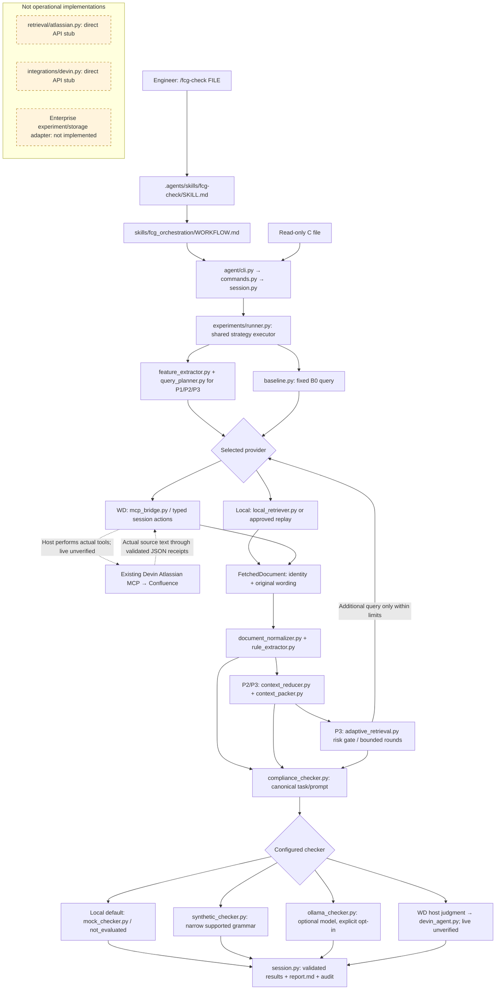
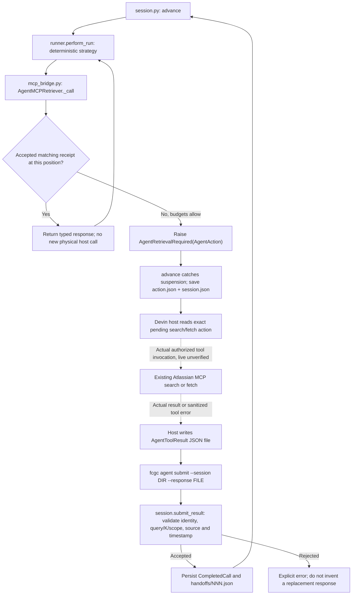
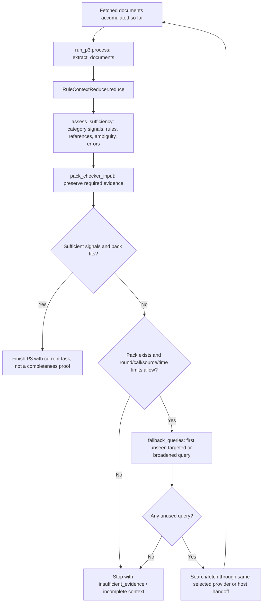
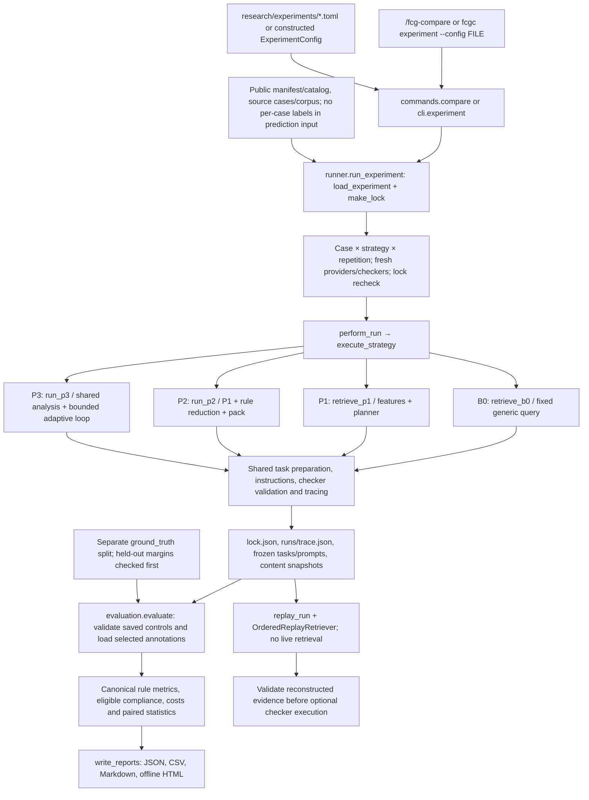

# Workflow diagrams

These diagrams describe the inspected **0.13.0** implementation. Python filenames
are relative to `src/fcgc/` unless another root is shown. Arrows mean actual calls,
data transfer or the labeled external host action—not a verified live service.

- **Local:** executable with synthetic fixtures and mock/bounded deterministic checking.
- **WD bridge:** implemented and contract-tested with fake host receipts; native/live access unverified.
- **Unimplemented:** explicit stubs or missing functionality, outside working paths.

Read the [beginner walkthrough](HOW_FCGC_WORKS.md) for the example, or the
[file interaction map](FILE_INTERACTION_MAP.md) for inputs, functions and failures.

## High-level architecture



B0/P1/R bypass reduction/gate. In P3 the reducer, assessment and packer run on each
retrieval round before the loop decides whether to continue. Arrows into canonical
task preparation represent alternative strategy outputs, not simultaneous branches.
The optional Ollama implementation exists; a real local model was not available
for this documentation verification.

## `/fcg-check` execution sequence

This diagram expands the **default local P3** command. It shows the important
calls rather than every import/validation helper. The WD interruption is expanded
in the next section.

```mermaid
sequenceDiagram
  actor E as Engineer
  participant H as Devin host / skill workflow
  participant C as agent/cli.py + commands.py
  participant S as agent/session.py
  participant R as experiments/runner.py
  participant P as retrieval/adaptive_retrieval.py
  participant L as LocalFixtureRetriever
  participant K as CanonicalChecker + configured provider

  E->>H: /fcg-check FILE [--function NAME]
  Note over H: Native Devin recognition/invocation still needs target verification
  H->>C: fcgc agent invoke --command ... --output ...
  C->>C: invoke_command → invoke → parse_command
  C->>S: start_session(source, settings, mode, strategy, limits)
  S->>S: load_firmware, optional function_location, lock and features
  S->>R: perform_run(..., checkers_enabled=False, task_transform=_focus)
  R->>P: execute_strategy → run_p3
  P->>P: extract_features → FCGQueryPlanner.plan
  loop Initial round, then only while warned and within limits
    P->>L: search(query, document_K)
    L-->>P: SearchResults in ranked order
    P->>L: fetch(new source IDs)
    L-->>P: Original FetchedDocument objects
    P->>P: extract_documents → reducer.reduce → assess_sufficiency
    P->>P: pack_checker_input; decide stop or next unique query
  end
  P-->>R: P3Run with final evidence, assessments, attempts and costs
  R->>R: prepare_task → freeze_packed_audit → render_checking_prompt
  R->>R: Final budget check, source hashes, diagnostic features and timings
  R-->>S: RunTrace with checking task; checker not invoked yet
  S->>R: execute_checkers(trace, config)
  R->>K: check(fresh FrozenCheckingTask)
  alt No rules or incomplete context
    K->>K: Return unresolved without substantive prediction
  else Complete supplied context
    K->>K: predict with canonical prompt; validate findings/citations
  end
  K-->>R: CheckingResult + CheckerExecution
  R-->>S: Checker results and checker-stage timing
  S->>S: save_session → summary + render_report
  S-->>C: Structured result with report path
  C-->>H: JSON stdout; nonzero on error
  H->>H: Read report.md and actual audit records
  H-->>E: Findings or explicit abstention, citations, warnings, report link
```

The mock never supplies a substantive decision, even with complete context. In
this walkthrough C001 remained incomplete and returned not_evaluated. `/fcg-rules`
shares retrieval/context processing but skips checking altogether.

## MCP handoff and adaptive fallback

### The host-to-Python request/receipt loop



On resumption, Python restarts deterministic computation and reuses prior validated
receipts. It does not continue an in-memory stack or reissue old physical calls.
Authentication/permission errors stop the workflow. Missing tools fail before WD
execution; local fixtures are not substituted. Physical pagination/cursor handling
is not automatic. Partial responses must be marked and cannot support a false
complete-context judgment.

A later `checking_required` action uses the same file/submit transport:
`task.json` + exact `checker-prompt.json` → host judgment → `AgentJudgment` JSON →
`validate_findings()` → `DevinAgentChecker`. No Python Devin API is involved.

### What actually triggers another retrieval round



These are observable warnings, not ground-truth knowledge or hidden Atlassian
confidence. P2 never enters this loop. Packing failure can stop fallback before
another query; it is not a reason to truncate normative evidence.

## B0/P1/P2/P3 experiment workflow



The save→evaluate arrow is orchestrated by `/fcg-compare`, `validate-local` or a
separate `fcgc report`; `run_experiment()` itself only records prediction runs.
Report-only commands start at saved controls and never fill missing runs by
retrieving again. Optional R uses the same shared remainder with a larger broad
reference document budget. See [research workflow](RESEARCH_WORKFLOW.md) for precise
K units, eligibility, grouped repetitions and limitations.

## Reading and verification notes

The Python edges were checked against `commands.py`, `session.py`, `runner.py`,
`adaptive_retrieval.py`, `mcp_bridge.py`, canonical checking and reporting source.
Representative local commands, a 24-run comparison, report generation and replay
were executed; the full suite passed. Diagram branching is source-verified;
no live MCP/Devin arrows are claimed as executed. Mermaid source is provided for
offline rendering by a compatible Markdown viewer, not as a screenshot of a running
enterprise system. Detailed measured example fields are in [How FCGC works](HOW_FCGC_WORKS.md).
